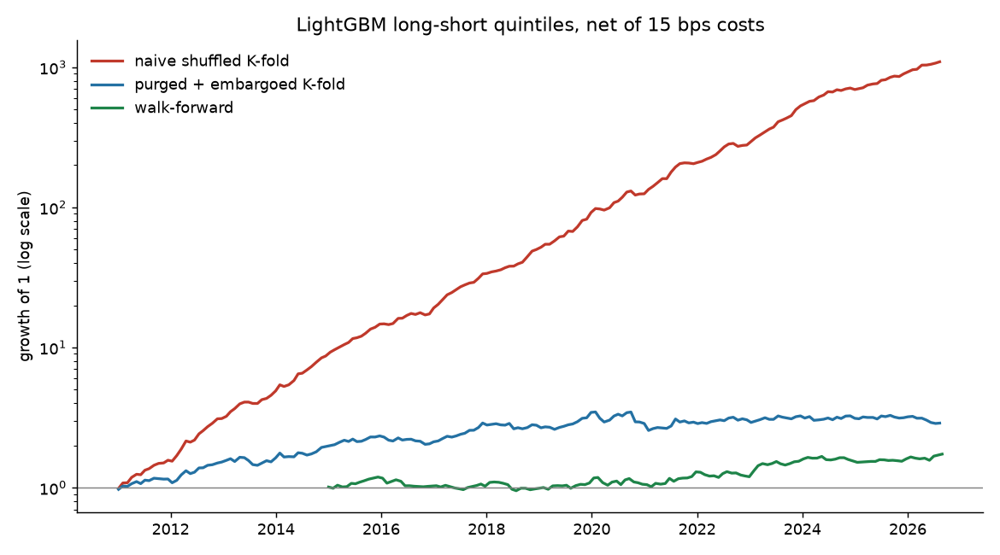

# Nifty ML Alpha

[](https://github.com/Subham1709/Nifty_ML_Alpha/actions/workflows/tests.yml)

Machine-learning stock selection on the Nifty 100, built around the question every quant
interviewer asks: *"how do you know your backtest isn't leaking?"*

A LightGBM model and a ridge baseline rank 98 Nifty 100 stocks by their next-month
(21 trading day) return, using 15 price and volume features. The predictions are
evaluated three ways, on daily data from 2010 to 2026:

1. **Naive shuffled K-fold**, the default in most ML tutorials.
2. **Purged and embargoed K-fold** (López de Prado, 2018), which removes training samples
   whose label window overlaps the test period.
3. **Walk-forward**: retrain every January on labels already known, test on that year.

Each is turned into a long-short quintile portfolio, rebalanced every 21 trading days,
net of 15 bps trading costs.

## Results



| Validation | Model | Mean IC | Net Sharpe | Net annual return |
|---|---|---|---|---|
| Naive shuffled K-fold | LightGBM | 0.171 | **3.95** | 58.1% |
| Purged + embargoed K-fold | LightGBM | 0.041 | 0.67 | 8.2% |
| Walk-forward | LightGBM | 0.030 | **0.51** | 5.4% |
| Naive shuffled K-fold | Ridge | 0.069 | 1.31 | 18.3% |
| Purged + embargoed K-fold | Ridge | 0.047 | 0.89 | 11.9% |
| Walk-forward | Ridge | 0.048 | **1.07** | 14.7% |

Full tables: [`results/summary.md`](results/summary.md),
[cost sensitivity](results/cost_sensitivity.md), [IC by year](results/ic_by_year.md),
[feature importance](results/feature_importance.md), [data report](results/data_report.md).

**What this shows**

- **Shuffled K-fold inflated LightGBM's Sharpe about 8x** (3.95 vs 0.51). Labels on
  consecutive days share 20 of their 21 days, so a shuffled split lets the model memorise
  its neighbours. The more flexible model leaks far more: ridge only drops from 1.31
  to 1.07.
- **Purged K-fold and walk-forward agree**, so purging and embargo remove the leak.
- **The simple model wins out of sample.** With a weak, noisy signal, ridge beat LightGBM
  on IC (0.048 vs 0.030) and on Sharpe after costs. LightGBM also traded more.
- **The signal is small and unstable**: walk-forward IC was positive in 8 of 12 years,
  and the LightGBM long-short Sharpe falls from 0.85 to 0.18 as costs go from 0 to 30 bps.

## Placebo test: does the validation work?

The same pipeline on 40 fake stocks whose prices are pure random walks, where the true
IC and Sharpe are exactly zero ([`scripts/00_placebo_test.py`](scripts/00_placebo_test.py)):

| LightGBM, long-short, net of 15 bps | Mean IC | Net Sharpe |
|---|---|---|
| Naive shuffled K-fold | 0.270 | **5.05** |
| Purged + embargoed K-fold | -0.007 | -0.32 |
| Walk-forward | -0.001 | -0.24 |

Naive K-fold finds a Sharpe of 5 in pure noise; the leak-free methods correctly find
nothing.

This is the finance version of my B.Tech project on landslide susceptibility mapping,
where a random train/test split made the model look far better than spatial-block
validation on unseen regions.

## Data and its problems

- Daily OHLCV from Yahoo Finance for today's Nifty 100 constituents, 2010-01 to 2026-09.
- A jump screen flags every one-day move over 35%. Three were unadjusted demergers
  (Adani Enterprises 2015, Tata Motors 2025, Vedanta 2026) and are neutralised; three
  were real moves (PSU bank recapitalisation 2017, the COVID rebound) and are kept.
- **Survivorship bias is measured, not ignored.** An equal-weight portfolio of today's
  constituents grew 19.2% a year since 2011 against 9.1% for the actual Nifty 100 index
  (price only). Much of that gap is hindsight in the stock list, which is why the
  long-short results (both legs from the same list) are the ones to trust. The long-only
  numbers in `summary.md` are inflated by it.

## Limitations

Current constituents only (no point-in-time membership), six model/validation
combinations tried without a Deflated Sharpe adjustment, flat 15 bps costs, no sector
neutralisation, and price/volume features only. See
[step 10 of the learning log](docs/LEARNING_LOG.md#step-10-limitations-and-next-steps).

## Reproduce

```bash
git clone https://github.com/Subham1709/Nifty_ML_Alpha && cd Nifty_ML_Alpha
pip install -r requirements.txt
pytest                               # look-ahead, leakage, backtest and cleaning tests
python scripts/00_placebo_test.py    # pipeline on random-walk prices (no signal)
python scripts/01_download.py        # Nifty 100 prices + indices, 2010-01 to 2026-09
python scripts/01b_data_report.py    # data checks -> results/data_report.md
python scripts/02_run_experiment.py  # 3 validation schemes x 2 models -> results/
```

Or run the **experiment** workflow from the Actions tab: it does all of the above on a
GitHub runner and commits `results/`. The numbers above come from that run; different
library versions can move them in the second decimal.

## Layout

```
src/alpha/      universe, data, cleaning, features, labels, CV, models, backtest
scripts/        runnable steps 00-02
tests/          look-ahead, purging, backtest and cleaning tests
docs/           learning log: what each step does, why, and interview notes
results/        tables and figures (committed by the experiment workflow)
```

## Reference

M. López de Prado, *Advances in Financial Machine Learning* (Wiley, 2018), ch. 7
(cross-validation in finance).
